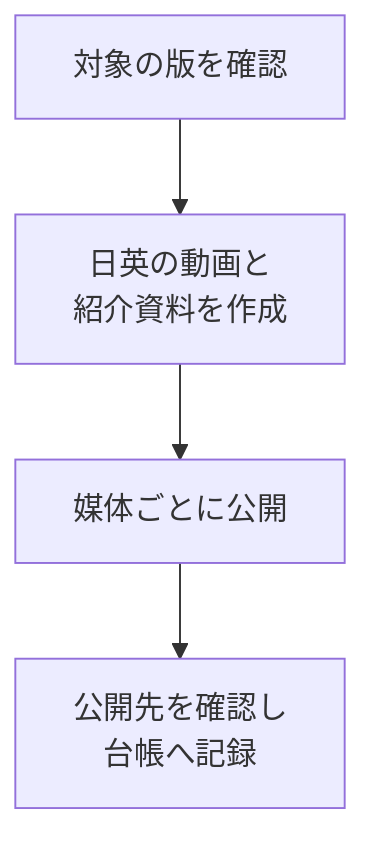

<!--
  ファイル名 / File: docs/MARKDOWN-CHECKLIST.md
  概要 / Description: Markdown と図(Mermaid)の書き方・確認のチェックリスト。全製品共通の正本(Identity 第8条 8-9) / Markdown and diagram (Mermaid) authoring and review checklist, shared by all products (Identity Art. 8-9)
  作成者 / Author: 5garashi.com設計事務所 / 5garashi.com Design Office
  作成日 / Created: 2026-10-17
  版 / Version: 4.20.0
  ライセンス / License: MIT
  SPDX-License-Identifier: MIT
-->
# Markdown・図(Mermaid)の書き方チェックリスト / Markdown and Diagram Checklist

5garashi.com の文書を Markdown で作成・修正するときに使う、全製品共通のチェックリストです。原則は [Design Office Identity](https://5garashi.github.io/5garashi-identity/) 第8条 8-9 にあり、このファイルはその具体的な確認項目です。製品ごとの描画エンジンの版・対応する記法・不具合と検証の記録は、各製品のリポジトリに置きます。

**構文が通ること、表示が読めること、内容が正しいことを、別々に確かめます。** 構文の検証や描画の成功(SVG ができた、エラーが出ない)だけで、表示の品質やアクセシビリティを確認済みとしません。

English: Check syntax, visible layout, and factual accuracy separately. A successful parse or SVG render does not prove that labels are readable, free of overlaps, or accessible. The principles are in Identity Art. 8-9; product-specific engine versions, supported syntax, and defect records live in each product's repository.

## 1. 文章と Markdown の基本 / Writing and Markdown basics

- [ ] 冒頭に、目的・対象(製品と版)・確認日を書いた。
- [ ] 見出しは `#`、`##`、`###` の順に階層を付け、飛ばさなかった。見出し・段落・リスト・表・コードブロックの前後に空行を置いた。
- [ ] リストを深く入れ子にしなかった。比べる項目は表、操作の順番は番号付きリストにした。
- [ ] 表には区切り行を入れ、セルの中の `|` はエスケープした。長い文章を1つのセルに詰め込まなかった。
- [ ] コードフェンスの開始と終了を対応させた。Markdown のコード例の中にコードフェンスを含めるときは、外側を4個以上のバッククォートにした。
- [ ] リンク先が実在する。手元の文書は相対パス、公開先は https で書いた。特定の PC の絶対パスを共有するリンクにしなかった。
- [ ] 画像には代替テキストを書き、図を読めない人にも分かる本文や表を用意した(Identity 7-4)。
- [ ] ファイルの先頭のヘッダー(9-3。Markdown では HTML コメント)、末尾の署名(9-5)、版と CHANGELOG(12-7)を、今回の改版に合わせた。
- [ ] 文章は第8条に沿っている。特に、ピラミッド構造(結論→理由・説明→詳細)で、文書全体・各節・各段落の頭に結論を置いた(8-2 (1))。1文1義にし、確かさを表す語を使い分けた(8-8)。

English: heading levels in order with blank lines around blocks; shallow lists; tables for comparisons and numbered lists for steps; escaped `|` in tables; matched code fences (four or more backticks outside when nesting); working links (relative locally, https when public, never one PC's absolute path); alt text plus a text or table equivalent (7-4); header (9-3), signature (9-5), version and CHANGELOG (12-7) updated; writing follows Art. 8, in a pyramid (conclusion, then reasons, then details) at every level (8-2 (1)).

## 2. 図を書く前に選ぶこと / Choosing a diagram

README などの Markdown 文書では、関係・流れ・手順・状態を図にすると分かりやすくなる場合、図(チャート)を活用します。記法は、GitHub の表示と mdEditor の両方で描画できる範囲の Mermaid を使います(5 節)。図を増やすこと自体を目的にせず、文章や表のほうが分かりやすい場合はそちらを選びます。

| 伝える内容 | 第一候補(Mermaid) | 読みにくいときの変え方 |
| --- | --- | --- |
| 作業の順番・日付ごとの工程 | `flowchart TD` | 工程ごとに図を分け、日付と詳細は表にする |
| 媒体・仕組み・ブランチの関係 | `flowchart LR` または `TD` | 横に広がるなら `TD` にし、図を分ける |
| 担当どうしのやり取り | `sequenceDiagram` | 参加者名とメッセージを短くし、段階ごとに分ける |
| 進み具合・待ち・やり直し | `stateDiagram-v2` | 状態名を短くし、条件の説明は本文へ移す |
| 短い出来事を日付で並べる | `timeline` | 長い日本語や列の重なりが出たら、縦の `flowchart` か表にする |

- [ ] 図にすると分かりやすくなる内容(関係・流れ・手順・状態)かを考えてから図にした。文章や表のほうが分かりやすいときは、そちらにした。

English: in READMEs and other Markdown documents, use a chart when relationships, flows, steps, or states become clearer as a picture, written in Mermaid both GitHub and mdEditor can render (section 5). Adding diagrams is never the goal; prefer text or a table when it is clearer.

## 3. 文字の重なりを防ぐ書き方 / Preventing overlaps

- [ ] ノードの ID は `A`、`Review` のような短い英数字にし、表示名は `A["日本語の表示名"]` のように引用符で囲んだ。
- [ ] 1つのノードには1つの作業・状態だけを書いた。URL、長い正式名称、制約の説明は本文や表へ移した。
- [ ] 日本語のラベルは短い句に分けた。目安として1行10〜16文字ほどから試すが、文字数だけで合否を決めなかった。
- [ ] 改行が要るところは、その図の種類で使える書き方で入れた(`flowchart` では `<br/>`)。すべての図の種類で同じ改行が使えるとは考えなかった。
- [ ] 横の列を増やす前に、`LR` から `TD` への変更や、図の分割を考えた。
- [ ] 図が横に広いとき、文字を小さくして収めるだけの直し方をしなかった。
- [ ] `timeline` の日本語の説明が枠の幅を越えていないか確かめた。長いときは余白の設定だけで済ませず、図の種類から見直した。
- [ ] ラベルが枠の中に収まり、隣のラベル・矢印・日付・凡例と重なっていないことを、画像で確かめた。

書き方の例(コードの例で、ここでは図として描画しません):

````markdown

````

English: short ASCII node IDs with quoted labels; one task or state per node; short Japanese phrases (try about 10–16 characters per line, but do not judge by count alone); line breaks the diagram type supports (`<br/>` in flowcharts); change direction or split before adding columns; never just shrink the text; check timeline cards; confirm in an image that nothing spills or overlaps.

## 4. 描画と表示を確かめる / Checking rendering and display

- [ ] 配る製品・環境と同じ描画エンジンと版で描画した。別のサイトや新しい版で描けたことだけで、成功としなかった(製品ごとの版と確かめ方は、その製品のリポジトリに書く。GitHub で読む Markdown は 5 節のとおり両方で確かめる)。
- [ ] 書体の読み込みが終わってから確かめた。書体・太さ・文字の大きさが変わると、幅の測り方も変わる。
- [ ] すべての図を、画像か実際のプレビューで見て、文字の重なり・切れ・枠からのはみ出しを確かめた。
- [ ] ふつうの画面の幅と、狭いプレビューの幅で確かめた。縮めると文字が極端に小さくなる図は分けた。
- [ ] 昼と夜(Identity 4-2)の両方で、文字と線が読めることを確かめた。色だけで状態を区別しなかった(7-2)。
- [ ] 図だけに情報を持たせず、要点を本文や表にも書いた(7-4)。
- [ ] PDF や HTML で配るときは、実際に書き出して確かめた。PDF は改ページ、図の途中での切れ、余白、リンクを見た。
- [ ] 自動の確認と目視の確認を分けて記録した。確かめていない表示の条件や読み上げを「確認済み」にしなかった(7-7、8-8)。

English: render with the same engine and version the product ships; check after fonts load; inspect every diagram for overlaps, clipping, and overflow at normal and narrow widths, in day and night palettes; never rely on color alone; keep a text equivalent; export PDF/HTML when distributing; record automated and visual checks separately and never mark unchecked conditions as checked.

## 5. GitHub と mdEditor の互換性 / GitHub and mdEditor compatibility

GitHub で読む Markdown(README など)は、GitHub の表示と mdEditor の両方で同じように読めることを求めます(Identity 8-9 (5)(7))。mdEditor が対応する記法・同梱する Mermaid の版・検証の結果は、mdEditor のリポジトリで確かめます。

製品の機能を説明・確認するための文書(機能の説明、サンプル、試験用の文書など。Identity 8-9 (8))と、文書ごとに表示先や記法の指定がある文書(8-9 (9))は、この節の互換の確認を省いてよい。その場合も、その製品での表示は 4 節のとおり確かめ、文書の冒頭に表示先の前提を書き、当てはめない文書と理由を製品の README に書く。

- [ ] 図は Mermaid のコードブロック(` ```mermaid `)で書いた。
- [ ] GitHub の表示と mdEditor の両方で描画し、文字の収まりと重なりを目で確かめた。一方で描画できたことだけで、互換性を確認済みとしなかった。
- [ ] GitHub のライト・ダークの両方の表示と、mdEditor の昼・夜の両方で、文字と線が読めることを確かめた。
- [ ] 一方の Mermaid の新しい版だけが対応する図の種類や書き方を使わなかった(両者の版は同じとは限らない)。
- [ ] Graphviz(DOT)や PlantUML など、両方で共通して直接描画できない記法を、Markdown の中の図にしなかった。必要なときは画像にして、代替テキストと本文の説明を付けた。
- [ ] ブラウザーの拡張機能、エディターのプラグイン、特定の環境だけの設定がなくても読める。
- [ ] 使える場合は、Mermaid の `accTitle`・`accDescr` で図の題と説明を付けた。付けたときは、両方の環境で描画が崩れないことを確かめた。

English: documents that explain or check product features (8-9 (8)) and documents with their own display-target instructions (8-9 (9)) may skip this section, but are still checked in the product per section 4, state their display assumption at the top, and are listed with the reason in the product's README. Otherwise: write diagrams as Mermaid code blocks; render and inspect them in both GitHub and mdEditor (success in one is not compatibility), in GitHub's light and dark display and mdEditor's day and night palettes; avoid syntax only one side's newer Mermaid supports; never use notation both cannot draw directly (Graphviz DOT, PlantUML, and so on) — use an image with alt text instead; require no extensions, plugins, or environment-specific settings; add `accTitle`/`accDescr` where supported, after checking both environments. mdEditor's supported syntax, bundled Mermaid version, and results live in the mdEditor repository.

## 6. 内容とリンクを確かめる / Checking content and links

- [ ] ソースの版・配布物(ストアなど)の版・資料の版を混同していない。
- [ ] 操作の名前・画面の文言が、対象の版と一致している。
- [ ] 新しい実演へのリンクと、古い画面や動画に写っている版の表示が合っている。
- [ ] 公開の段階(原稿の完成・保存・送信・審査中・公開を確かめた)を区別して書いた。
- [ ] 公開先のアカウント名と公開の範囲を確かめ、URL・確認日・根拠を残した。
- [ ] ほかのファイルから生成した文書を直すときは、生成元も直した。ほかの人のまだコミットしていない変更を混ぜなかった。

English: keep source, distribution, and document versions distinct; match operation names to the target version; keep links and pictured versions consistent; distinguish publishing stages; record URLs, dates, and evidence; fix generators too, and never mix in others' uncommitted work.

## 7. 確認記録のひな形 / Check record template

| 項目 | 書くこと |
| --- | --- |
| 対象の文書・版 | ファイル名、文書の版、製品(ソース)の版 |
| 確認日・担当 | 日付と担当(人・AI) |
| 描画エンジン | 実際に使ったものと、その版 |
| 表示環境 | GitHub(ライト・ダーク)、mdEditor(版と昼・夜)など、実際に見たもの |
| 自動の確認 | 図の数、構文、相対リンクなど |
| 目視の確認 | 対象の図、画面の幅、書体、昼・夜、重なりや切れの有無 |
| 書き出し | PDF・HTML など、実際に行ったものだけ |
| 確かめていないこと・残る問題 | 表示の条件、読み上げ、改ページなど |

ソフトウェアの出荷前チェック全体の記録は、Identity 9-5 のひな形を使います。

---

**作成者 / Author**: 5garashi.com設計事務所 / 5garashi.com Design Office
**最終更新 / Last updated**: 2026-10-17 JST
